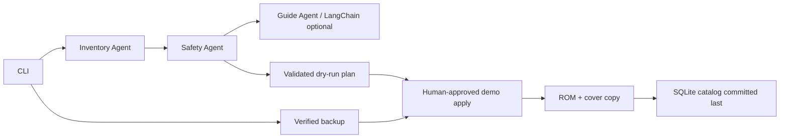

# GameStick AI Manager 🎮🤖

**A safe hands-on Python project for exploring GameStick SD-card management and mini AI-agent orchestration.**


## The problem

A small retro game console often stores ROMs, metadata, artwork and favorites on an SD
card. Manually copying files and editing databases is error-prone: one mismatch can
break the game list. This project teaches a safer workflow: **inspect → back up →
plan → review → request consent → apply → verify**.

This repository is an independent educational POC, inspired by real-world GameStick
management. **It does NOT write to a physical GameStick card.** The included local
fixture simulates an SD card and a SQLite `games.db` catalog. Real firmware adapters
are future work, not advertised as implemented.

## Features (working MVP)

- Inspect a simulated card and list games, systems, metadata and favorites.
- Create SHA-256-verified complete backups; reuse a matching backup automatically.
- Validate an update package (`games.json`) and produce a dry-run plan.
- Add/replace a demo ROM and optional cover without deleting unrelated games.
- Update a simulated SQLite catalog, preserving existing favorites on replacement.
- Restore backed-up files on explicit approval.
- Run a mini-orchestration: `InventoryAgent → SafetyAgent → GuideAgent`.
- Use **LangChain + ChatOpenAI** for an optional structured, read-only explanation.
- Earn educational XP badges for inventory, backups and safe planning.
- GitHub Actions, pytest, Ruff, CLI and architecture docs.

## Quick start (no API key required)

Use Python 3.11+ on **macOS, Windows or Linux**. All example operations below are local
and do not access a physical SD card.

```bash
python -m venv .venv
# macOS / Linux:
source .venv/bin/activate
# Windows PowerShell: .venv\Scripts\Activate.ps1
python -m pip install -e '.[dev]'

gamestick demo --card workspace/card --package workspace/package
gamestick inspect --card workspace/card
gamestick plan --card workspace/card --package workspace/package
gamestick backup --card workspace/card --backups backups
gamestick ai-review --card workspace/card --package workspace/package --backups backups
```

Without `OPENAI_API_KEY`, `ai-review` returns an **offline summary**. For a model-backed
review, install the optional integration and set a key in your environment:

```bash
python -m pip install -e '.[ai,dev]'
# Export OPENAI_API_KEY using your OS shell; NEVER commit credentials.
gamestick ai-review --card workspace/card --package workspace/package --backups backups
```

The `GuideAgent` uses `ChatOpenAI.with_structured_output` from LangChain. It **cannot**
run commands or alter the approved plan. Pricing and availability depend on your API account.

## Apply a change (SIMULATED SD CARD ONLY)

First run `plan` and `backup`, then opt in explicitly:

```bash
gamestick apply --card workspace/card --package workspace/package --backups backups --execute --confirm "APPLY DEMO CHANGES"
gamestick inspect --card workspace/card
```

By default, `apply` performs a **dry-run**. Any actual local update requires a verified
backup and the exact authorization phrase. A successful update adds the fake `New Demo`
ROM to the local fixture; it does not install a playable NES title.

To restore a snapshot, choose the backup directory returned by `backup`:

```bash
gamestick restore --card workspace/card --backup backups/backup-YYYYMMDDTHHMMSS-ABC123
gamestick restore --card workspace/card --backup backups/backup-YYYYMMDDTHHMMSS-ABC123 --execute --confirm "RESTORE DEMO BACKUP"
```

**Restore is overlay-only**: it restores original files, but does not automatically
remove new files added since the snapshot. A full rollback would also require a
guided review of new paths.

## Example package

The `demo` command creates a package containing this manifest:

```json
{
  "games": [
    {"system": "nes", "title": "New Demo", "source": "demo_game.nes"}
  ]
}
```

To include art, add a PNG/JPG/WebP file to the package and set `"cover": "cover.png"`.
The demo's catalog uses paths such as `roms/nes/new-demo.nes` and
`covers/nes/new-demo.png`. **These paths are not guaranteed on your real GameStick.**

Supported **demo** systems/extensions: `nes/.nes`, `snes/.sfc/.smc`, `gba/.gba`,
`genesis/.md/.bin/.gen`, `ps1/.cue/.chd/.pbp`. This list is only a validation allowlist
and is not a claim of emulator compatibility. Multi-file formats such as `.cue` with
`.bin` companions require a future adapter; this POC does not resolve their links.

## Architecture



The word *agent* here describes three orchestration roles. Inventory and safety are
**deterministic Python components**; the GuideAgent is the only optional LLM-backed
component. This keeps the human in control and avoids giving a language model
filesystem permissions.

## Repository structure

```text
src/gamestick_ai/
  cli.py            CLI commands and approval gates
  demo.py           Synthetic SD card and sample game fixtures
  catalog.py        SQLite demo catalog adapter
  fs.py             Safe paths, hashes and atomic file copies
  backup.py         Full snapshot, SHA-256 verification and reuse
  inventory.py      Game and favorites inventory
  planner.py        Package validation, destination planning
  apply.py          Confirmed writes to demo card, DB last
  restore.py        Explicit overlay restore
  agents.py         Inventory → Safety → LangChain Guide
  gamification.py   Optional XP badges
configs/firmware-profiles/  real-firmware adapter design notes
docs/                     architecture, security, ADR
examples/                 additional setup notes
.github/workflows/        continuous integration
 tests/                    executable unit tests
```

## Test it

```bash
pytest -q
ruff check src tests
```

## Technical boundaries / roadmap

| Capability | Status |
|---|---|
| Synthetic SD card, SQLite catalog | Implemented |
| Game inventory + favorite preservation | Implemented (demo) |
| Verified backup and reuse | Implemented (demo) |
| ROM and cover import from local user-owned files | Implemented (demo) |
| Safe restore | Implemented (overlay only) |
| LangChain explanation with API key | Implemented (optional; requires API) |
| Real SD-card detection (Windows/macOS/Linux) | Planned |
| Real `tbl_game` schema / R2 favorites adapter | Not implemented |
| Firmware fingerprinting and compatibility verification | Planned |
| GUI with progress and resumption | Planned |
| ROM download/search | Not included |

### Why not automatically update a real device?

GameStick 4K / M8 / M15 variants may have different partition maps and schemas.
Forcing a generic updater could corrupt favorites or break menus. A future real
adapter needs read-only schema discovery, sanitized fixtures, storage tests and
explicit user consent; see [firmware profiles](configs/firmware-profiles/README.md).

## Responsible use

Use only ROMs, box art and other files you own or are permitted to use. No bundled
commercial games, copyrighted artwork, downloading, elevated privileges or device writes.

## Contributors

Contributions are welcome. See GitHub commit history for attribution.

## License

MIT — see [LICENSE](LICENSE).

## Read-only scan of a real, mounted SD card

You may inspect a card mounted by the operating system **without changing anything**:

```bash
# macOS example (replace with your actual mount path)
gamestick scan-card --mount /Volumes/YOUR_SD_CARD

# Windows example: gamestick scan-card --mount E:\\
# Linux example: gamestick scan-card --mount /media/$USER/YOUR_SD_CARD
```

This command lists only extension counts and possible `games.db`/`database.sqlite3`
table names (read-only). **It does not guarantee that a card is GameStick-compatible**
or expose a write function for real firmware. Files on unsupported ext4 partitions
may require a separate read-only mount; this tool does not mount or elevate permissions.
