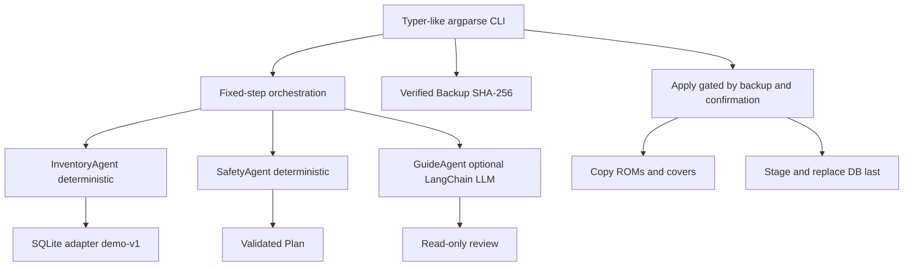

# Architecture

Core rule: the LLM cannot authorize actions. It receives only an inventory summary
and validated plan; the application makes all security decisions and executes writes.

The backup is a full **snapshot** of the demo card, with file-level SHA-256 checksums.
It is verified and reused if an identical snapshot already exists. Apply copies ROMs
and covers before replacing the DB. The update is not a whole-card atomic transaction.
Restore overlays backed-up paths but doesn't delete files added since the backup.
